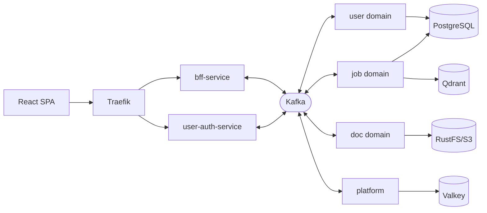

# Nohiki

[](https://github.com/mchar7/nohiki-monorepo/actions/workflows/checks.yml)
[](https://github.com/mchar7/nohiki-monorepo/actions/workflows/build-push.yml)
[](LICENSE)

**Discover, organize, track, tailor, and evaluate job opportunities in one workspace.**

Use Nohiki to gather postings, extract structured details with an LLM, compare them with your target profile through
learning-to-rank scoring, and prepare tailored resume and cover-letter PDFs. You review the evidence and every document,
choose which roles to pursue, and submit each application yourself.

The architectural bet: backend services exchange domain work **only through Kafka**. HTTP business APIs exist at two
edges (the BFF and auth service, both behind Traefik). Other services use HTTP only for internal health and metrics, so
each event-driven service can be deployed, scaled, or replaced on its own.

## Architecture



<!-- markdownlint-disable MD033 -->
<!-- Native details/summary is required for this collapsible inventory; Markdown has no equivalent. -->
<details>
<summary><strong>Service inventory</strong></summary>

| Domain   | Service                              | Role                                            |
| -------- | ------------------------------------ | ----------------------------------------------- |
| User     | `user-auth-service`                  | JWT authentication and identity (HTTP + Kafka)  |
| User     | `user-pref-service`                  | Job target profiles and preferences             |
| User     | `user-upload-service`                | Document storage on S3                          |
| User     | `user-entitlement-service`           | Billing and tier logic                          |
| Job      | `job-ingest-discovery-service`       | Scrapes postings from source sites              |
| Job      | `job-ingest-enrichment-service`      | LLM analysis and structured extraction          |
| Job      | `job-ingest-schedule-service`        | Scrape scheduling                               |
| Job      | `job-storage-service`                | Canonical job store with deduplication          |
| Job      | `job-query-composition-service`      | Query composition over the job corpus           |
| Job      | `job-correlation-evaluation-service` | ML scoring, matching, learning-to-rank          |
| Doc      | `doc-template-service`               | Templates and PDF rendering via Gotenberg       |
| Doc      | `doc-content-service`                | Resume and cover letter content generation      |
| Doc      | `doc-process-service`                | Document parsing with Docling                   |
| Platform | `bff-service`                        | Backend-for-frontend API gateway (HTTP + Kafka) |
| Platform | `notification-service`               | Email via SendGrid/Resend                       |
| Platform | `ml-gateway-service`                 | ML request routing                              |
| Platform | `ml-compute-service`                 | In-cluster ML compute worker                    |
| Platform | `skill-graph-service`                | Skill normalization and graph management        |

Kafka-only services expose no business HTTP APIs, but they do expose internal health and metrics endpoints. Each service
directory has its own README and, where it owns tables, a DATABASE.md describing database responsibilities, lifecycle,
invariants, and operational behavior.

</details>
<!-- markdownlint-enable MD033 -->

## Database migration workflow

Stateful services use clean-cut deployment: stop the services, drop and recreate their schemas, and apply each baseline
Alembic revision to the empty database. Update the baseline revision in place rather than accumulating incremental
revisions.

This workflow is possible because Nohiki is pre-release and has no production data. It does not require data migrations
or backward compatibility between schema versions.

Run these commands from the service directory:

```bash
uv run alembic upgrade head
uv run alembic revision --autogenerate -m "description"
uv run alembic current
```

## Repository map

| Path                                                              | Contents                                                                     |
| ----------------------------------------------------------------- | ---------------------------------------------------------------------------- |
| [`backend/services/`](backend/services)                           | The microservices                                                            |
| [`backend/libs/`](backend/libs)                                   | Shared `nohiki-*` libraries: Kafka client, DB utils, settings, observability |
| [`backend/jobs/`](backend/jobs)                                   | One-shot and scheduled jobs                                                  |
| [`typescript/apps/frontend/`](typescript/apps/frontend/README.md) | The React SPA                                                                |
| [`typescript/edge/`](typescript/edge)                             | Cloudflare Worker at the edge                                                |
| [`proto/`](proto)                                                 | Protobuf event contracts, linted and breaking-change-gated with buf          |
| [`infra/compose/`](infra/compose/README.md)                       | Local full-stack environment                                                 |
| [`infra/k8s/`](infra/k8s/helm/README.md)                          | Helm charts, GitOps (Flux v2), kafka-connect                                 |
| [`infra/terraform/`](infra/terraform/README.md)                   | OpenTofu configuration for Azure infrastructure                              |
| [`tests/`](tests/README.md)                                       | Cross-service API tests and E2E journeys                                     |
| [`scripts/`](scripts)                                             | CI check runner, ML data generation, utilities                               |
| [`models/`](models)                                               | Tracked model artifacts for the ranking pipeline                             |

## Development

The dev environment is a Nix flake; [direnv](https://direnv.net/) activates it and syncs both package ecosystems:

```bash
git clone https://github.com/mchar7/nohiki-monorepo.git
cd nohiki-monorepo
direnv allow
```

**Without Nix**: install the pinned toolchain yourself ([uv](https://docs.astral.sh/uv/), Node, Corepack + pnpm,
[just](https://github.com/casey/just), a POSIX shell; versions live in [`flake.nix`](flake.nix)), then run
`uv sync --all-packages` and `corepack pnpm install`. The `just` recipes and `.envrc` defaults work the same either way.

Day-to-day work goes through [`just`](Justfile):

```bash
just compose-up          # bring up the full local stack
just compose-health      # verify it end to end
just fix                 # auto-fix lint + format
just typecheck-all       # backend + frontend
just test-all-packages   # pytest across the whole workspace
just test-e2e-journey smoke   # Playwright against the live stack
```

<!-- markdownlint-disable MD033 -->
<!-- Native details/summary is required for this collapsible shell list; Markdown has no equivalent. -->
<details>
<summary><strong>Targeted Nix shells</strong></summary>

| Shell    | Command                  | Contents                                                                        |
| -------- | ------------------------ | ------------------------------------------------------------------------------- |
| Default  | `nix develop`            | Everything: Python, Node, containers, infra                                     |
| Backend  | `nix develop .#backend`  | Python, uv, buf, grpcurl                                                        |
| Frontend | `nix develop .#frontend` | Node.js only                                                                    |
| Infra    | `nix develop .#infra`    | kubectl, helm, OpenTofu, azure-cli                                              |
| K8s      | `nix develop .#k8s`      | kubectl, Helm, k9s and container tooling; bring your own cluster (`KUBECONFIG`) |
| CI       | `nix develop .#ci`       | Minimal for pipelines                                                           |

</details>
<!-- markdownlint-enable MD033 -->

With the stack up: API gateway on `:8000` (docs at [`/api/docs`](http://localhost:8000/api/docs)), frontend dev server
on `:5173` (`pnpm --filter nohiki-frontend dev`), Grafana on `:3001` when the observability profile is running. The full
port map is in [`infra/compose/`](infra/compose/README.md).

## Quality gates

[`lefthook`](lefthook.yml) defines the local gate contract:

- Commit-message hooks run commitlint and the internal-reference check.
- Pre-commit runs Python Ruff lint and format, frontend Biome lint and format, protobuf and Markdown lint, frontend i18n
  validation, staged-secret scanning, GitHub Actions lint, and Dockerfile lint. Lefthook skips pre-commit during merges
  and rebases.
- Pre-push runs:
  - Internal-reference range validation
  - Python lint, format, typecheck, and affected tests
  - Skylos cache tests
  - Node workspace contract tests
  - Frontend typecheck and tests
  - Nix flake check
  - Dependency hygiene
  - Strict dead-code analysis
  - Semgrep checks
  - Strict backend build policy
  - Frontend architecture checks
  - API schema freshness
  - Image matrix parity
  - Protobuf breaking-change detection

The installed wrapper forces every pre-push job to run and prevents Lefthook environment variables from disabling a
normal push. It cannot protect a hook that Git does not invoke: `git push --no-verify` bypasses pre-push completely.
Measured full pre-push runs took about 180 seconds warm and 420 seconds cold, with strict dead-code analysis taking
about 270 seconds of the cold run.

[CI](.github/workflows/checks.yml) distributes the corresponding gates across independent hosted runners. Contract tests
keep the local and hosted surfaces aligned. CI also adds commit-message validation, a full-history secrets scan, and
Trivy scans on every [built image](.github/workflows/build-push.yml).

Conventions, worktree layout, and branch naming live in [CONTRIBUTING.md](CONTRIBUTING.md).

## License

[AGPL-3.0-only](LICENSE). Commercial terms are available; see [LICENSING.md](LICENSING.md). Contact:
[@mchar7](https://github.com/mchar7).
