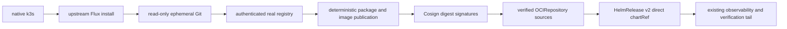

# Deterministic signed OCI Helm proof

`infra/k8s/oci-proof/proof.py` is the repository-owned binary decision for the
local Git + OCI delivery architecture. It packages and deploys the complete
`nohiki-foundation` and `nohiki` charts; it never substitutes a fixture chart.

## Prerequisites and invocation

Run on Linux from a clean commit with the repository's pinned Kubernetes tools
on `PATH`. The host independently provisions the executable
`nohiki-oci-proof-privileged`; the helper is not implemented, installed, or
owned by this repository, and its provisioning is deliberately
distribution-neutral. Its `PATH` entry may be a symlink: the proof resolves the
helper to its absolute real path before every invocation, so the host can grant
passwordless non-interactive `sudo` to that immutable target only. The helper
pins k3s and exposes only the proof's validated `check`, `start`,
`chown-kubeconfig`, `journal`, and `stop` operations; no shell, k3s, systemd
command, file utility, or general wheel privilege belongs in the `NOPASSWD`
boundary. Mutable `/var/lib/rancher/k3s` state must be absent, and ports 6443,
19418, and 30500 must be free. Host declarative configuration at
`/etc/rancher/k3s/config.yaml` is permitted because the adapter must start the
disposable server with `--config /dev/null`, isolating it from that default
configuration. Supply the existing local SOPS identity and reviewed
secret-source directory as absolute paths:

```console
SOPS_AGE_KEY_FILE=/absolute/path/to/age.agekey \
NOHIKI_LOCAL_SECRETS_DIR=/absolute/path/to/secret-sources \
CONTAINER_RUNTIME=podman \
just k8s-oci-helm-proof
```

The proof refuses a dirty checkout, missing required tools, an active cluster,
unavailable privilege, missing secret inputs, or an occupied port before it
mutates host state. `python infra/k8s/oci-proof/proof.py self-check` validates
the tracked templates without contacting a cluster.

## Ordered topology



Flux is installed natively because no controller can reconcile itself. The
actual digest-pinned Distribution registry remains Git-managed because an OCI
host cannot fetch itself. Signing keys exist only in the mode-0700 runtime
directory; Git receives the public PEM only. Both chart sources use the same
physical registry repository identity for host signing and in-cluster
verification.

The state machine builds dependencies through the reviewed, no-argument
`just helm-dependencies` contract in a disposable clone. It verifies lock to
archive closure, packages both real charts twice, canonicalizes tar and gzip
metadata, and requires byte equality. Versions 0.1.0/0.1.1 and 0.2.0/0.2.1
must differ only in the packaged root `Chart.yaml` version.

Before a positive install, unique sources prove unsigned, wrong-key,
unauthorized, and false-digest failures. Every negative case requires no
source artifact, Helm history, Helm storage, target namespace, or install
event. Positive v1 delivery, both-chart v2 upgrade, both-chart v1 rollback,
external dependency isolation, Helm drift correction, and the existing full
local verification tail must all pass.

Files ending in `.yaml.in` are reviewed templates, not active Kubernetes
resources. The renderer accepts an explicit token set and rejects unresolved
tokens, private material, tag or semver selectors, malformed digests, and OCI
repositories without exactly one SHA-256 `ref.digest`.

## Evidence and decision

Each run creates `.artifacts/oci-helm-proof/<UTC-run-id>/` before cluster
mutation. `result.json` uses schema `nohiki.oci-helm-proof/v1` and has exactly
`PASS` or `FAIL`, an exact failed contract identifier, source HEAD, ephemeral
Git commits, timestamps, and teardown result. Separate records cover tool and
source pins, package hashes and closure, registry digests, public-key hashes,
all four negative cases, v1/v2/rollback state, isolation, drift, verification
jobs, and teardown. Kubernetes Secrets, authorization data, passwords,
kubeconfig credentials, SOPS identities, and signing private keys are never
recorded. A deterministic `evidence.tar.gz` and SHA-256 remain after teardown.

There is no partial pass. A source/lock, reproducibility, bootstrap, registry,
signature, authentication/digest, direct chartRef, dependency-isolation,
drift, end-to-end health, or teardown failure makes the architecture decision
`FAIL` under its corresponding contract ID. Teardown runs unconditionally;
cleanup failure overrides any earlier success as `TEARDOWN_INCOMPLETE`.

This is a local proof boundary. It does not use Flux Operator, GitHub OIDC,
cloud workload identity, a second registry, a production tag reference, or a
committed private key.
